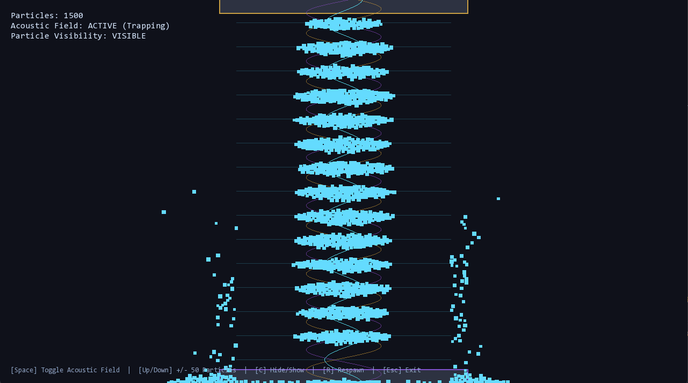

# Acoustic Particle Engine

A high-performance 2D real-time physics simulation of acoustic waves, particle interactions, and acoustic levitation built in **modern C++20** and rendered with **SFML** using **Data-Oriented Design (DOD)**.

Based on acoustic radiation force theory and experimental standing wave levitators (e.g., Andrade et al., *Revista Brasileira de Ensino de Física*, 2015).

---



---

## Key Features

- **Acoustic Levitation Physics:** Implements the Gor'kov acoustic radiation force:
  $$F_z = \frac{5\pi R^3 A^2 k}{6\rho c^2} \sin(2kz)$$
  Counter-propagating sound waves from a top ultrasonic transducer ($40\text{ kHz}$) and a bottom reflector interfere to form a vertical standing wave, trapping particles stably in acoustic pressure nodes at half-wavelength intervals ($\lambda / 2$).
- **Wave Interference Visualization:** Real-time visual superposition showing:
  - Downward traveling wave from the transducer ($\cos(ky - \omega t)$ in amber)
  - Upward reflected wave from the reflector ($\cos(ky + \omega t)$ in purple)
  - Stationary standing wave interference ($\cos(ky)\cos(\omega t)$ in glowing cyan)
- **Decoupled Fixed-Timestep Loop:** 120 Hz deterministic physics simulation decoupled from 60 Hz display rendering via a fixed accumulator.
- **Verlet Numerical Integration:** Time-reversible Störmer-Verlet solver with Stokes viscous air drag damping.
- **Spatial Partitioning ($O(N)$ Uniform Grid):** Reduces particle-particle collision complexity from $O(N^2)$ to $O(N)$ using flat contiguous memory lookup.
- **GPU Batch Rendering:** Renders thousands of particles and wave fields in single draw calls via `sf::VertexArray`.
- **Live On-Screen Display (HUD):** Telemetry showing particle count and acoustic field status, alongside interactive keyboard controls.

---

## Architecture (Modular & Data-Oriented Design)

Designed around **Data-Oriented Design (DOD)** and CPU cache locality rather than heavy object-oriented virtual inheritance:

- **`Core/`**: Pure mathematical utilities (`Vec2`) and zero-overhead data structures (zero external dependencies).
- **`Physics/`**: Struct of Arrays (SoA) particle memory layout (`ParticleSystem`), Verlet solver (`VerletSolver`), uniform spatial grid (`Grid`), and acoustic radiation force equations (`AcousticField`). Isolated from graphics.
- **`Graphics/`**: Encapsulates SFML and implements single-draw-call GPU batch rendering (`BatchRenderer`) for particles and acoustic wave interference overlays.
- **`App/`**: Manages the application window, live HUD text, keyboard interaction, and fixed-timestep orchestration.

---

## Tech Stack

- **Language:** C++20 (`g++` / MinGW-w64 UCRT)
- **Build System:** CMake 3.24+ & Ninja
- **Rendering:** SFML 2.6.2 (fetched and linked statically via CMake `FetchContent`)
- **Testing:** CTest automated test suite (7 unit test suites)

---

## Build, Test & Run

```powershell
# 1. Configure CMake and fetch dependencies
cmake -B build -G Ninja

# 2. Compile all modules, tests, and the main executable
cmake --build build

# 3. Run automated test suite (100% pass)
ctest --test-dir build --output-on-failure

# 4. Run the simulation
.\build\AcousticParticleEngine.exe
```

---

## Interactive Controls

- **`Spacebar`**: Toggle acoustic levitation field **ON / OFF** (observe particles float in acoustic nodes vs. collapse under gravity).
- **`Up Arrow (↑)`**: Add **+50 particles** into the simulation in real time.
- **`Down Arrow (↓)`**: Remove **-50 particles** from the simulation.
- **`C`**: Toggle particle visibility **ON / OFF** (hides particles to clearly inspect the pure wave interference field).
- **`R`**: Reset and respawn default particles across the chamber.
- **`Esc`**: Exit the simulation.
